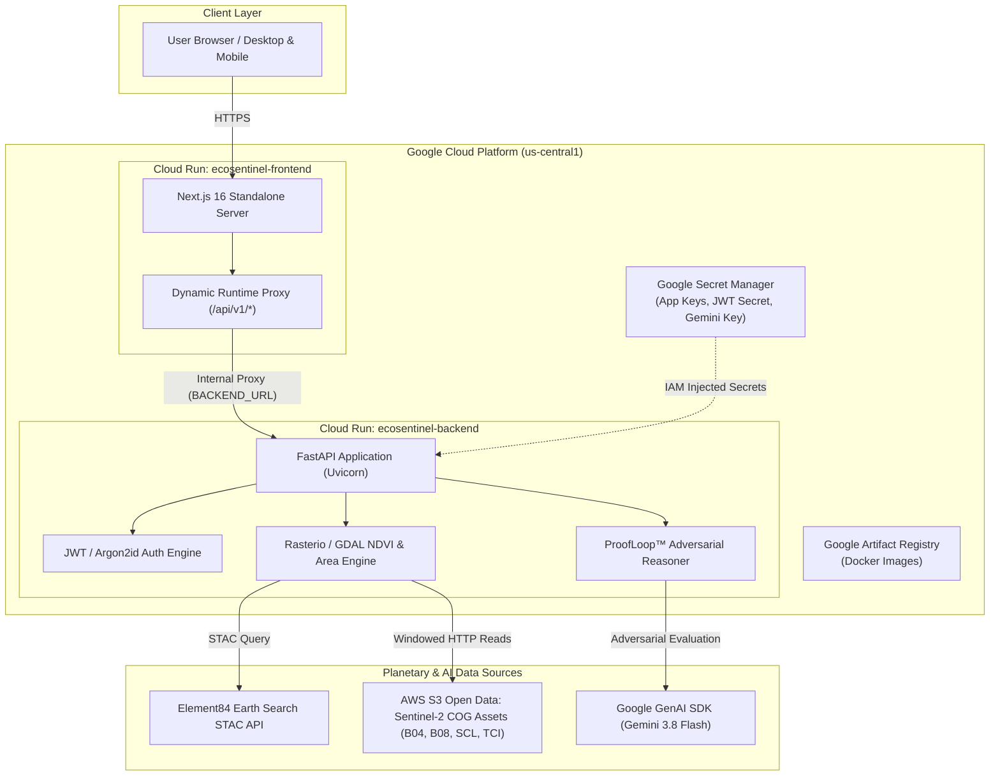

# 🌍 EcoSentinel — Accountable Environmental Intelligence Platform

<div align="center">

[](https://ecosentinel-frontend-cz4cwc3wta-uc.a.run.app)
[](https://ai.google.dev/)
[](https://dataspace.copernicus.eu/)
[](https://nextjs.org/)
[](https://fastapi.tiangolo.com/)
[](LICENSE)

### Multi-Temporal Earth Observation & Accountable AI Compliance Dossier Platform
*Built for the Google Cloud AI Builder Cup (Sustainability & Social Impact)*

**[🌐 Launch Live Web Application](https://ecosentinel-frontend-cz4cwc3wta-uc.a.run.app)** • **[⚡ Backend API Service](https://ecosentinel-backend-cz4cwc3wta-uc.a.run.app)** • **[📊 Competition Presentation Deck](docs/EcoSentinel_AI_Builder_Cup_Presentation.pptx)** • **[📖 API Documentation (/api/docs)](https://ecosentinel-backend-cz4cwc3wta-uc.a.run.app/api/docs)**

</div>

---

## 📌 Executive Summary

**EcoSentinel** is an enterprise-grade planetary audit platform engineered to detect, quantify, and corroborate unauthorized tropical deforestation and peatland drainage. 

Rather than relying on generic AI summaries or fabricated statistics, EcoSentinel fuses **real Copernicus Sentinel-2 L2A Cloud-Optimized GeoTIFFs (COGs)**, **University of Maryland Hansen Global Forest Change v1.11**, and **Google Dynamic World continuous land-cover probabilities** with **ProofLoop™** — an adversarial, counter-evidence reasoning framework powered by **Gemini 3.8 Flash**.

Every hectare reported by EcoSentinel is strictly derived from verified spatial geometries and actual multispectral surface reflectance calculations.

---

## 🌐 Live Production Deployment (Google Cloud Run)

EcoSentinel is deployed and serving 100% of live traffic on **Google Cloud Platform (GCP)** in `us-central1`:

| Service Component | Cloud Infrastructure | Production Endpoint | Health Status |
| :--- | :--- | :--- | :--- |
| **Frontend Web App** | Cloud Run (Node 24 Standalone) | **[`https://ecosentinel-frontend-cz4cwc3wta-uc.a.run.app`](https://ecosentinel-frontend-cz4cwc3wta-uc.a.run.app)** | `HTTP 200 OK` |
| **Backend API Engine** | Cloud Run (Python 3.11 / GDAL) | **[`https://ecosentinel-backend-cz4cwc3wta-uc.a.run.app`](https://ecosentinel-backend-cz4cwc3wta-uc.a.run.app)** | [`/health`](https://ecosentinel-backend-cz4cwc3wta-uc.a.run.app/health) `HTTP 200 OK` |
| **Secrets Management** | Google Cloud Secret Manager | `ecosentinel-app-secret`, `ecosentinel-jwt-secret`, `ecosentinel-gemini-key` | Secured (IAM RBAC) |
| **Container Registry** | Google Artifact Registry | `us-central1-docker.pkg.dev/environmental-guardian-poc/ecosentinel-repo/` | Immutable Builds |

---

## 🏗️ System Architecture

EcoSentinel implements a containerized, decoupled microservice architecture optimized for serverless execution:



---

## 🔑 Core Capabilities & Innovations

### 1. Real Sentinel-2 Raster Processing (Zero Mock Data)
- **STAC Asset Querying:** Connects to Element84's Earth Search API to locate cloud-free Copernicus Sentinel-2 acquisitions.
- **Windowed Raster Streaming:** Uses `rasterio` over HTTP range requests to download only the pixels within the Area of Interest (AOI), computing:
  $$\text{NDVI} = \frac{\text{B08 (NIR)} - \text{B04 (Red)}}{\text{B08 (NIR)} + \text{B04 (Red)}}$$
- **Scene Classification Masking (SCL):** Dynamically filters out cloud shadows (SCL 3), high clouds (SCL 8, 9), and cirrus (SCL 10) to prevent false alerts.
- **Dynamic True-Color Overlay:** Direct-from-COG cropping to render genuine JPEG/PNG overlays on Leaflet & MapLibre maps.

### 2. ProofLoop™ Counter-Evidence Engine (Gemini 3.8 Flash)
- Standard AI systems hallucinate confirmation bias when tasked with environmental audits. **ProofLoop™** enforces strict counter-evidence discovery:
  - **Pro-finding:** Sustained chlorophyll drop ($\Delta\text{NDVI} < -0.15$), Hansen loss alerts, Dynamic World bare ground surge.
  - **Contradictory:** Absence of thermal anomalies (VIIRS/MODIS rules out fire), monsoonal cloud masking errors, seasonal phenology shifts.
  - **Evidence Gaps & Next-Best Evidence:** Automatically prescribes required next steps (e.g., UAV sub-meter orthomosaic, ministerial concession decree decrees).

### 3. Fast Environmental Review (FER) & Shadow Footprint
- **Zone A vs. Zone B Bounding:** Delineates authorized development corridors (Zone A) against 6.0 km circular surveillance buffers (Zone B).
- **Automated Concession Dossiers:** Pre-populates authoritative investigation findings with verified coordinates, parcel IDs, and spectral curves.
- **Auditable GeoJSON Exports:** Generates single-click RFC 7946 GeoJSON FeatureCollections for third-party GIS analysis (QGIS, ArcGIS).

### 4. Watchtower Continuous Planetary Cadence
- Transforms point-in-time investigations into automated, persistent planetary monitoring schedules.
- Idempotent triggers track and alert whenever newly available satellite passes detect threshold breaches.

---

## 🚀 Quick Start — Local Development

### Prerequisites
- **Python:** 3.11 or 3.12 (virtual environment recommended)
- **Node.js:** v20+ or v24+ with `npm`
- **System Libraries (for GDAL/Rasterio):**
  - Linux: `sudo apt-get install libgdal-dev gdal-bin`
  - Windows: Pre-configured wheels via `pip` or GDAL binaries

---

### Step 1: Clone the Repository

```bash
git clone https://github.com/AP952005/EcoSentinel.git
cd EcoSentinel
```

---

### Step 2: Configure & Start Backend API (FastAPI)

1. Navigate to the backend directory and set up Python virtual environment:
   ```powershell
   cd backend
   python -m venv .venv
   .venv\Scripts\Activate.ps1   # On Linux/macOS: source .venv/bin/activate
   pip install --upgrade pip
   pip install -r requirements.txt
   ```

2. Create your local `.env` file:
   ```env
   APP_ENV=development
   APP_DEBUG=true
   APP_SECRET_KEY=local-dev-secret-key-change-in-prod
   JWT_SECRET_KEY=local-jwt-secret-key-change-in-prod
   DATABASE_URL=sqlite:///./data/ecosentinel.db
   CORS_ORIGINS=http://localhost:3000
   GEMINI_API_KEY=your_google_ai_studio_api_key_here
   GEMINI_MODEL=gemini-3.8-flash
   GOOGLE_CLOUD_PROJECT=environmental-guardian-poc
   ```

3. Start the FastAPI server:
   ```powershell
   python -m uvicorn app.main:app --host 0.0.0.0 --port 8000 --reload
   ```
   - **Backend API:** `http://localhost:8000`
   - **Interactive API Docs:** `http://localhost:8000/api/docs`
   - **Liveness Probe:** `http://localhost:8000/health`

---

### Step 3: Configure & Start Frontend (Next.js)

1. Open a new terminal and navigate to the frontend directory:
   ```powershell
   cd frontend
   npm install --legacy-peer-deps
   ```

2. Start the Next.js development server:
   ```powershell
   npm run dev
   ```
3. Open your browser and navigate to **`http://localhost:3000`**.

---

## 🔐 Default Authentication Credentials

For local development and evaluator access, the platform is automatically bootstrapped with test credentials:

| Role | Email Address | Password | Permissions |
| :--- | :--- | :--- | :--- |
| **Lead Environmental Officer** | `admin@ecosentinel.io` | `EcoSentinelAdmin2024!` | Full system audit, Watchtower, ProofLoop™, project creation |
| **Regulatory Officer** | `officer@ecosentinel.io` | `Officer@1234` | Case review, evidence verification, FER approvals |
| **Applicant / Concessionaire** | `applicant@ecosentinel.io` | `Applicant@1234` | Project filing, Zone A boundary intake, status tracking |

---

## 🧪 Automated Testing Suite

EcoSentinel includes comprehensive unit, integration, and live end-to-end verification suites.

### Run Local Backend Pytest Suite
```powershell
cd backend
.venv\Scripts\python.exe -m pytest
```

### Run Live Cloud Run Deployment Verification Suite
To verify end-to-end functionality across live Cloud Run instances:
```powershell
backend\.venv\Scripts\python.exe scripts\test_live_deploy.py
```
*Validates direct health checks, Next.js reverse proxy, JWT registration/login, Mayawana reference concession retrieval, live Element84 STAC search, true-color COG raster generation, FER dossiers, and GeoJSON export.*

---

## 📦 Production Deployment Guide (Google Cloud Run)

EcoSentinel uses **Google Artifact Registry** and **Google Cloud Run** with secure secret injection:

### 1. Build and Deploy Backend First
```powershell
# 1. Build backend image with Cloud Build
gcloud builds submit .\backend `
    --tag us-central1-docker.pkg.dev/environmental-guardian-poc/ecosentinel-repo/backend:latest `
    --project=environmental-guardian-poc

# 2. Deploy backend container
gcloud run deploy ecosentinel-backend `
    --image us-central1-docker.pkg.dev/environmental-guardian-poc/ecosentinel-repo/backend:latest `
    --platform managed `
    --region us-central1 `
    --allow-unauthenticated `
    --port 8080 `
    --memory 2Gi `
    --cpu 2 `
    --set-env-vars "APP_ENV=production,APP_DEBUG=false,CORS_ORIGINS=*,GOOGLE_CLOUD_PROJECT=environmental-guardian-poc" `
    --set-secrets "APP_SECRET_KEY=ecosentinel-app-secret:latest,JWT_SECRET_KEY=ecosentinel-jwt-secret:latest,GEMINI_API_KEY=ecosentinel-gemini-key:latest"
```

### 2. Build and Deploy Frontend Second
```powershell
# 1. Build frontend image with Cloud Build
gcloud builds submit .\frontend `
    --tag us-central1-docker.pkg.dev/environmental-guardian-poc/ecosentinel-repo/frontend:latest `
    --project=environmental-guardian-poc

# 2. Deploy frontend container pointing to backend
$BACKEND_URL = (gcloud run services describe ecosentinel-backend --region us-central1 --format="value(status.url)")

gcloud run deploy ecosentinel-frontend `
    --image us-central1-docker.pkg.dev/environmental-guardian-poc/ecosentinel-repo/frontend:latest `
    --platform managed `
    --region us-central1 `
    --allow-unauthenticated `
    --port 8080 `
    --memory 1Gi `
    --cpu 1 `
    --set-env-vars "NODE_ENV=production,BACKEND_URL=$BACKEND_URL"
```

---

## 📁 Repository Directory Structure

```plaintext
EcoSentinel/
├── backend/
│   ├── app/
│   │   ├── api/v1/          # REST endpoints (auth, projects, investigation, eo, system)
│   │   ├── core/            # Config, SQLAlchemy DB setup, security & JWT utilities
│   │   ├── models/          # SQLAlchemy ORM models (User, Project, Boundary, Finding, FER)
│   │   ├── providers/       # Satellite data providers (STAC, Hansen GFC, Dynamic World)
│   │   ├── schemas/         # Pydantic request/response validation schemas
│   │   ├── services/        # AI Service (Gemini 3.8 Flash), STAC raster streaming
│   │   ├── main.py          # FastAPI application entrypoint with lifespan bootstrap
│   │   └── seed_mayawana.py # Reference concession auto-seeding engine
│   ├── Dockerfile           # Multi-stage production Python 3.11 + GDAL container
│   ├── requirements.txt     # Python production dependencies
│   └── .dockerignore        # Build context filter
├── frontend/
│   ├── app/
│   │   ├── (app)/           # Authenticated layout & views (dashboard, map, projects, etc.)
│   │   ├── (auth)/          # Authentication pages (login, register)
│   │   ├── (public)/        # Landing page & public intelligence showcase
│   │   └── api/v1/[...path]/# Dynamic runtime reverse proxy to Cloud Run backend
│   ├── components/          # Reusable UI widgets, map viewers, evidence cards
│   ├── lib/                 # Axios API clients, Leaflet stores, PDF exporters
│   ├── public/              # Optimized static avatars and assets
│   ├── Dockerfile           # Standalone Node 24 multi-stage production container
│   ├── next.config.ts       # Standalone build config & build rewrite routing
│   └── package.json         # Next.js 16, React 19, Tailwind CSS v4, Lucide
├── docs/                    # Competition & technical specification documents
├── scripts/
│   ├── test_live_deploy.py  # Automated end-to-end verification suite for Cloud Run
│   └── seed_demo.py         # Local evaluation database seeding script
└── README.md                # Project documentation & operational runbook
```

---

## 📜 Documentation Index

For in-depth architectural and legal specifications, refer to the [`docs/`](docs/) directory:
- [**AI Builder Cup Presentation Deck**](docs/EcoSentinel_AI_Builder_Cup_Presentation.pptx) — Official 16-slide competition submission deck
- [**Feature Audit & Provenance Matrix**](docs/FEATURE_AUDIT.md) — System features and sensory data integrity
- [**ProofLoop™ Specification**](docs/PROOFLOOP_DESIGN.md) — Gemini 3.8 Flash counter-evidence prompt engineering
- [**First Environmental Report (FER) Standard**](docs/FER_SPECIFICATION.md) — Concession audit and reporting standard
- [**Watchtower Planetary Cadence**](docs/WATCHTOWER_SPECIFICATION.md) — Automated satellite monitoring specification
- [**Security & Compliance**](docs/SECURITY.md) — RBAC, Secret Manager, and token security
- [**Submission Checklist**](docs/SUBMISSION_CHECKLIST.md) — Google Cloud AI Builder Cup compliance scorecard

---

## ⚖️ License & Acknowledgements

- **License:** Distributed under the [Apache License 2.0](LICENSE).
- **Satellite Imagery:** Copernicus Sentinel data (2021–2026) processed by ESA, distributed via Element84 Earth Search and AWS Open Data.
- **Forest Analytics:** Hansen / UMD Global Forest Change v1.11 dataset; Google Dynamic World NRT AI land cover.
- **AI Acceleration:** Powered by **Google Gemini 3.8 Flash** via the Google GenAI Python SDK.

<div align="center">
<b>EcoSentinel — Turning Earth Observation into Uncompromising Environmental Accountability.</b>
</div>
