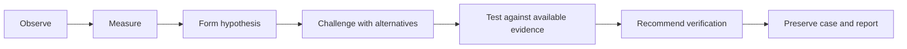
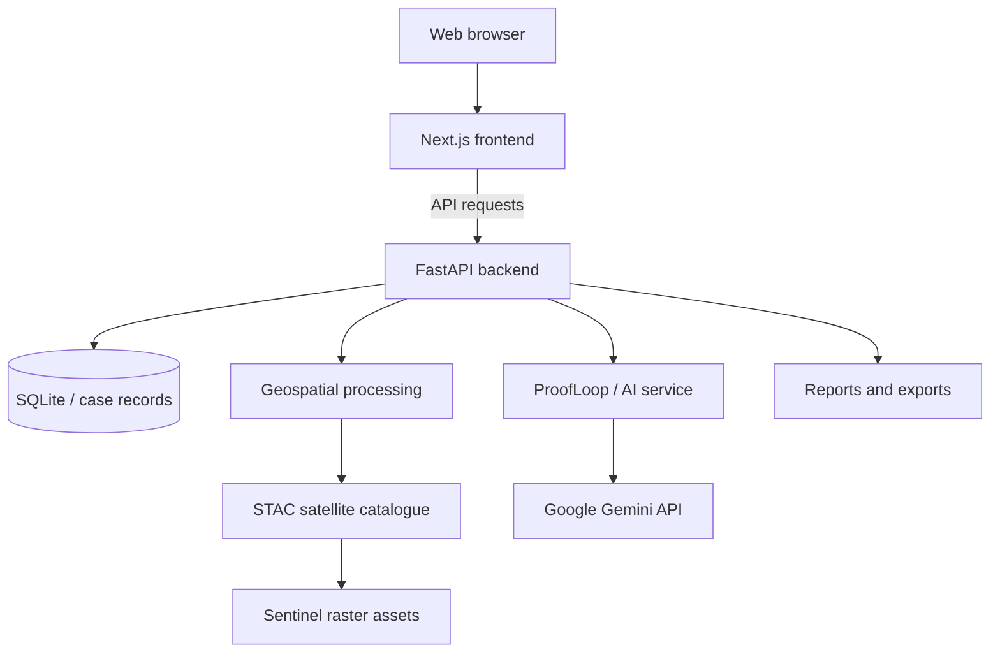

<div align="center">

# 🌍 EcoSentinel ProofLoop

### Environmental Intelligence • Satellite Change Analysis • Evidence-Grounded AI

**From satellite observations to traceable, reviewable environmental investigations.**

[](https://cloud.google.com/run)
[](https://ecosentinel-frontend-cz4cwc3wta-uc.a.run.app)
[](https://ai.google.dev/)
[](https://nextjs.org/)

[](https://dataspace.copernicus.eu/)
[](https://fastapi.tiangolo.com/)
[](https://nextjs.org/)

[](https://cloud.google.com/run)
[](https://fastapi.tiangolo.com/)
[](LICENSE)


**[Live Application](https://ecosentinel-frontend-cz4cwc3wta-uc.a.run.app)** · **[Backend API](https://ecosentinel-backend-cz4cwc3wta-uc.a.run.app)** · **[API Docs](https://ecosentinel-backend-cz4cwc3wta-uc.a.run.app/api/docs)**

*Developed for the Google Cloud AI Builder Cup — Sustainability & Social Impact*

</div>

---

## Overview

**EcoSentinel ProofLoop** is an AI-assisted environmental investigation platform that brings satellite imagery, multi-temporal geospatial analysis, evidence assessment, and reporting into a connected workflow. It is designed for conservation analysts, environmental officers, GIS specialists, and reviewers who need to understand **what changed, what the data actually supports, what else might explain it, and what to verify next**.

Unlike a conventional satellite dashboard or chatbot, EcoSentinel's defining concept is **ProofLoop**: a structured process that evaluates both supporting and contradicting evidence before producing a reviewable investigation record.

> **Scientific boundary:** A change in satellite reflectance or vegetation index is not, by itself, proof of deforestation, illegal activity, intent, or regulatory non-compliance. Findings require source validation and human review.

<p align="center">
  
</p>

<p align="center">
  <i>A visual introduction to the environmental
  challenges that inspired EcoSentinel ProofLoop.</i>
</p>

## The Problem

Environmental investigations often require switching between satellite catalogues, map viewers, GIS tools, project records, and reporting systems. This fragmentation makes it difficult to preserve the exact observations, calculations, and uncertainties behind a conclusion.

EcoSentinel aims to unify this workflow while keeping measurements separate from AI interpretation.

## Core Capabilities

| Module | Purpose |
| --- | --- |
| **Environmental Map** | Explore an area of interest (AOI), choose coordinates and radius, and inspect imagery and layers. |
| **Satellite Comparison** | Compare observations from different dates or years and inspect environmental change candidates. |
| **Geospatial Analysis** | Process compatible satellite assets and derive indices such as NDVI, with appropriate masking and source metadata. |
| **ProofLoop** | Organize supporting evidence, alternative explanations, contradictions, uncertainty, and next verification steps. |
| **Project Intake / FER** | Prepare preliminary environmental screening and project records. |
| **Shadow Footprint** | Compare candidate changes against supplied or validated reference footprints and surrounding areas. |
| **Watchtower** | Organize monitoring plans and investigation history; distinguish scheduled checks from completed analysis. |
| **AI Assistant** | Help explore case evidence and supported actions using a configurable Gemini runtime. |
| **Reports & Exports** | Prepare shareable investigation outputs, including PDF and structured geospatial formats. |

**Implementation note:** These modules are described in the project's existing implementation README and product blueprint. Their end-to-end completeness, live-data coverage, and production readiness should be verified against the running code. The blueprint also identifies several ongoing improvements.

## What Makes ProofLoop Different?



1. **Observe:** Select real satellite products with acquisition dates, scene IDs, coverage, and quality information.
2. **Measure:** Calculate reproducible indices and candidate changes from compatible source pixels.
3. **Hypothesize:** Frame a provisional interpretation, not an automatic legal conclusion.
4. **Challenge:** Ask Gemini to identify supporting evidence, counter-evidence, and plausible alternatives.
5. **Test:** Use backend analysis for alternatives that can actually be evaluated; mark untested ideas explicitly.
6. **Recommend:** Identify the most useful next observation, specialist check, or field verification.
7. **Preserve:** Save the evidence, parameters, uncertainty, and reviewer context in an investigation record.

ProofLoop's intended evidence states are **Supported**, **Weakened**, and **Inconclusive**. Insufficient evidence should never be converted into a definitive finding.

## Technology Stack

| Layer | Technologies described in the project |
| --- | --- |
| Frontend | Next.js 16, React 19, TypeScript, Tailwind CSS |
| Mapping | Leaflet / MapLibre |
| Backend | Python, FastAPI, Pydantic |
| Geospatial processing | Rasterio, GDAL, NumPy; Sentinel-2 raster assets |
| Database | SQLite, SQLAlchemy |
| AI | Google GenAI SDK, Gemini API (model configured via environment) |
| Satellite discovery | STAC; Element84 Earth Search and other supported catalogues |
| Reports | ReportLab, JSON / CSV / GeoJSON workflows |
| Deployment | Docker, Google Cloud Run, Artifact Registry, Secret Manager |
| Authentication | JWT-based authentication, as described in the implementation README |

**Data integrity:** Sentinel-2 NDVI is calculated from near-infrared (B08) and red (B04) reflectance:

$$NDVI = \frac{NIR - Red}{NIR + Red}$$

Valid analysis requires suitable source products, cloud/shadow masks, compatible spatial alignment, and sufficient AOI coverage. External forest-loss datasets can provide corroborating context but should not be substituted for AOI-specific measurements.

## System Architecture



The supplied implementation README also describes separate frontend and backend services deployed to **Google Cloud Run**, with credentials managed through **Google Cloud Secret Manager**. The URLs below are project-provided endpoints; their current availability has not been independently verified for this README.

| Component | Endpoint |
| --- | --- |
| Web application | [EcoSentinel frontend](https://ecosentinel-frontend-cz4cwc3wta-uc.a.run.app) |
| Backend service | [EcoSentinel backend](https://ecosentinel-backend-cz4cwc3wta-uc.a.run.app) |
| API documentation | [Swagger UI](https://ecosentinel-backend-cz4cwc3wta-uc.a.run.app/api/docs) |
| Health check | [Backend health](https://ecosentinel-backend-cz4cwc3wta-uc.a.run.app/health) |

## Example Investigation: Mayawana, Indonesia

The project blueprint identifies **Mayawana, West Kalimantan** as the reference forest-change investigation.

| Parameter | Reference configuration |
| --- | --- |
| Location | West Kalimantan, Indonesia |
| Center | `-0.924587, 109.941413` |
| Default radius | 2 km |
| Baseline | 2021 |
| Comparison | 2023 |
| Investigation objective | Examine potential forest-cover change using valid, comparable observations |

A representative workflow is to select the AOI, inspect actual source scenes, compare vegetation indices, review alternative explanations through ProofLoop, and generate a source-linked report. **No specific forest-loss area or change percentage is claimed here without validated AOI-level calculations.**

Contextual references: [Auriga Nusantara](https://auriga.or.id/press_release/detail/52/massive-deforestation-in-borneo-destroying-orangutan-habitat) · [Nusantara Atlas](https://map.nusantara-atlas.org/?s=6216fa519bd327cc4496ff1af6f6a7aa)

## Getting Started Locally

### Prerequisites

- Python **3.11 or 3.12**
- Node.js **20+** and npm (the supplied deployment uses Node.js 24)
- Git
- Compatible GDAL/Rasterio installation
- A Google AI Studio API key for Gemini-dependent features

### 1. Clone the repository

```bash
git clone https://github.com/AP952005/EcoSentinel.git
cd EcoSentinel
```

### 2. Start the backend

```bash
cd backend
python -m venv .venv
```

Activate the virtual environment:

**Windows PowerShell**
```powershell
.venv\Scripts\Activate.ps1
```

**macOS / Linux**
```bash
source .venv/bin/activate
```

Install dependencies:

```bash
python -m pip install --upgrade pip
pip install -r requirements.txt
```

Create `backend/.env` with local development settings:

```dotenv
APP_ENV=development
APP_DEBUG=true
APP_SECRET_KEY=replace-with-a-unique-local-secret
JWT_SECRET_KEY=replace-with-a-different-unique-local-secret
DATABASE_URL=sqlite:///./data/ecosentinel.db
CORS_ORIGINS=http://localhost:3000
GEMINI_API_KEY=your_google_ai_studio_api_key
GEMINI_MODEL=your_supported_gemini_model
```

Use a model available to your Google AI Studio project. Do not assume that a model identifier appearing in older documentation is currently supported.

Start the server:

```bash
python -m uvicorn app.main:app --host 127.0.0.1 --port 8000 --reload
```

Backend: `http://localhost:8000` · API docs: `http://localhost:8000/api/docs`

### 3. Start the frontend

In another terminal, from the repository root:

```bash
cd frontend
npm install --legacy-peer-deps
npm run dev
```

Open **http://localhost:3000**.

> If the frontend cannot reach the backend, check the project's frontend proxy configuration and `BACKEND_URL` settings. Never commit real `.env` files, credentials, or database secrets.

## Testing

From the `backend` directory, with its virtual environment activated:

```bash
python -m pytest
```

The existing project README also describes a deployment verification script:

```powershell
# Run from the repository root on Windows
backend\.venv\Scripts\python.exe scripts\test_live_deploy.py
```

This script is intended to exercise deployment health and key workflows. **Passing test results and live service health are not independently asserted here.** Review test output before making production-readiness claims.

## Repository Layout

```text
EcoSentinel/
├── backend/
│   ├── app/
│   │   ├── api/v1/          # API endpoints
│   │   ├── core/            # Configuration and security
│   │   ├── models/          # Database models
│   │   ├── providers/       # External data integrations
│   │   ├── schemas/         # Request/response schemas
│   │   ├── services/        # Analysis and AI services
│   │   └── main.py          # FastAPI entry point
│   ├── requirements.txt
│   └── Dockerfile
├── frontend/
│   ├── app/                 # Next.js routes
│   ├── components/          # UI components
│   ├── lib/                 # Clients and shared logic
│   ├── public/              # Static assets
│   └── package.json
├── docs/                     # Project and technical documentation
├── scripts/                  # Utility and verification scripts
└── README.md
```

*This layout is based on the supplied implementation README; check the repository for the latest structure.*

## Deployment

The existing project documentation describes Dockerized frontend and backend services on **Google Cloud Run**, with images stored in **Artifact Registry** and runtime secrets injected through **Secret Manager**.

For deployment, configure a dedicated Google Cloud project, enable the required services, build each image, deploy the backend first, and point the frontend's `BACKEND_URL` to the backend service. Use environment-specific credentials, least-privilege IAM, and appropriately restricted CORS. Do not copy development secrets or publicly expose administrative test accounts.

## Current Scope & Validation Priorities

The product blueprint identifies these as key acceptance goals:

- [ ] Verify at least one complete, reproducible real-satellite investigation.
- [ ] Confirm AOI, radius, observation dates, map layers, and reports remain consistent.
- [ ] Validate scene IDs, raster processing, masks, measurements, and provenance.
- [ ] Confirm ProofLoop distinguishes executed tests from untested hypotheses.
- [ ] Verify saved cases reopen with their evidence after restart.
- [ ] Confirm Watchtower records actual run outcomes and errors.
- [ ] Validate PDF and structured exports against the active case.
- [ ] Record test results and any remaining fixture/replay-data limitations.

These are **verification checkpoints**, not a claim that each feature is missing or incomplete. The uploaded documents do not contain independent test evidence sufficient to mark them complete.

## Responsible Use

EcoSentinel supports environmental screening and investigation preparation. Its outputs are **not** legal determinations, proof of unauthorized land use, or substitutes for professional GIS interpretation, official boundaries, field inspections, and regulatory review. Data gaps, cloud contamination, seasonality, and model limitations should be communicated explicitly.

## Data Sources & Acknowledgements

- [Copernicus Sentinel](https://dataspace.copernicus.eu/) — satellite observation data.
- [Element84 Earth Search](https://earth-search.aws.element84.com/v1) — STAC catalogue and asset discovery.
- [Google Gemini API](https://ai.google.dev/) — evidence-assisted reasoning.
- [University of Maryland Global Forest Change](https://glad.earthengine.app/view/global-forest-change) and [Google Dynamic World](https://dynamicworld.app/) — supplementary forest/land-cover context described in the implementation README.
- [Auriga Nusantara](https://auriga.or.id/) — contextual reporting for the Mayawana example.

## License

The existing implementation README identifies the project as **Apache License 2.0**. See [LICENSE](LICENSE) for the repository's actual license terms; ensure this file is included before publishing the badge or licensing claim.

---

<div align="center">

**EcoSentinel ProofLoop**

*Observe change. Challenge assumptions. Preserve evidence.*

</div>
